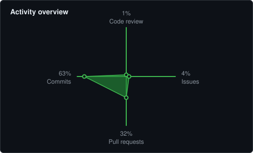
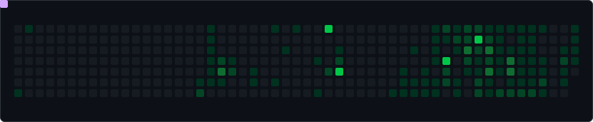

# Hi there, I'm Bhumika! 👋

**AI Developer Intern @ Dakini AI** · ISE @ DSATM (CGPA 9.28) · open-source contributor · hackathon winner

I build AI agents that fix themselves, CUDA solvers that go 8.7× faster, and ship a lot of pull requests.

  
  
  
  
  

---

## 🌍 Open Source

**[292 merged pull requests](https://github.com/search?q=is%3Apr+author%3ABhumika-1432006+is%3Amerged+-user%3ABhumika-1432006&type=pullrequests)** across 21 repositories in Python, TypeScript, Go and C.

| Project | ⭐ | Merged | Highlights |
|---|---|---|---|
| [last30days-skill](https://github.com/mvanhorn/last30days-skill/pulls?q=is%3Apr+author%3ABhumika-1432006+is%3Amerged) | 72k | 6 | Regression tests for percent-encoding to prevent `UnicodeEncodeError` on non-Latin topics ([#1234](https://github.com/mvanhorn/last30days-skill/pull/1234)) |
| [OpenSRE](https://github.com/Tracer-Cloud/opensre/pulls?q=is%3Apr+author%3ABhumika-1432006+is%3Amerged) | 14k | 2 | Slack webhooks, Datadog metrics and Grafana alert correlation in the AI SRE agent ([#4983](https://github.com/Tracer-Cloud/opensre/pull/4983)) |
| [cloudflare-docs](https://github.com/cloudflare/cloudflare-docs/pulls?q=is%3Apr+author%3ABhumika-1432006+is%3Amerged) | 5.5k | 1 | Docs fix |
| [cli-printing-press](https://github.com/mvanhorn/cli-printing-press/pulls?q=is%3Apr+author%3ABhumika-1432006+is%3Amerged) | 5k | 4 | Fixed concurrent `os.Stderr` race conditions ([#4947](https://github.com/mvanhorn/cli-printing-press/pull/4947)) |
| [future-agi](https://github.com/future-agi/future-agi/pulls?q=is%3Apr+author%3ABhumika-1432006+is%3Amerged) | 2.3k | 1 | Bug fix |
| [printing-press-library](https://github.com/mvanhorn/printing-press-library/pulls?q=is%3Apr+author%3ABhumika-1432006+is%3Amerged) | 2.1k | 5 | `npx` PATH, stale `REDMINE_URL`, Notion and OpenRouter docs ([#2276](https://github.com/mvanhorn/printing-press-library/pull/2276)–[#2280](https://github.com/mvanhorn/printing-press-library/pull/2280)) |
| [Reticle](https://github.com/reticlehq/reticle/pulls?q=is%3Apr+author%3ABhumika-1432006+is%3Amerged) | 1.3k | 12 | Screenshot race fix, TanStack `isInvalidated`, ARIA-role hints ([#1722](https://github.com/reticlehq/reticle/pull/1722)–[#1724](https://github.com/reticlehq/reticle/pull/1724)) |
| [Bernstein](https://github.com/sipyourdrink-ltd/bernstein/pulls?q=is%3Apr+author%3ABhumika-1432006+is%3Amerged) | 1.2k | 36 | DLP scanner ([#5885](https://github.com/sipyourdrink-ltd/bernstein/pull/5885)), tamper-evident SIEM hash-chains ([#5605](https://github.com/sipyourdrink-ltd/bernstein/pull/5605)), sandbox bypass removed ([#5673](https://github.com/sipyourdrink-ltd/bernstein/pull/5673)) |
| [Copperhead](https://github.com/copperheadhq/copperhead/pulls?q=is%3Apr+author%3ABhumika-1432006+is%3Amerged) | 700 | 1 | `doctor` health-check for `openspec` ([#193](https://github.com/copperheadhq/copperhead/pull/193)) |
| [CWIST](https://github.com/c4punks/CWIST/pulls?q=is%3Apr+author%3ABhumika-1432006+is%3Amerged) | – | 83 | Top contributor |
| [agit](https://github.com/agitHQ/agit/pulls?q=is%3Apr+author%3ABhumika-1432006+is%3Amerged) | – | 10 | |

**In review at:** PyTorch · VS Code · Ollama · crewAI · Supabase · Bun · Excalidraw · Zulip · Infisical · OpenAI Cookbook

---

## 🏆 Featured Projects

### 🚨 [Nikaas](https://github.com/thegoodengineers/Nikaas): Evacuation Digital Twin · 🥇 1st Prize, AfterHours 1.0 AWS Hackathon
Topological graph load-balancing cut egress time by **44.6%**. Wheelchair-aware DAG routing and crowd-density audits, validated over 200 Monte Carlo runs.
`Python` `React` `TypeScript` `NumPy` `AWS Lambda`

### 🔧 [Mend](https://github.com/thegoodengineers/mend): Self-Repairing AI Agent · 🥉 3rd Global, neatHack 2026 (205 teams, 64 countries)
An agent that reads its own neatlogs traces, fixes its own code and proves the fix. **−62.5%** cost, **−58%** tokens, automated Git rollback gates.
`Python` `TypeScript` `Claude Code` `MCP` · 🌐 **[Live](https://thegoodengineers.github.io/mend/)**

### ⚡ [Sankhya](https://github.com/thegoodengineers/SANKHYA): GPU Optimization Solver · Smart India Hackathon 2026
GPU-accelerated LP / MILP / convex QP solver for refinery logistics. Up to **8.7× speedup** on NVIDIA A100/L4 over CPU baselines.
`C/C++` `CUDA` `Python` · 🌐 **[Live](https://sankhya-solver.vercel.app)**

### 📸 [SnapClass AI](https://github.com/Bhumika-1432006/Snap-Class): Smart Attendance · 📄 IEEE RICE 2026 (#026688) · 🥇 1st Prize, PBL Hackathon
Face recognition with a voice roll-call fallback, passwordless face login, teacher and student portals, QR sessions, and *"Your Semester, Roasted"*.
`Python` `Dlib` `Supabase` `Streamlit` · 🌐 **[Live](https://snap-class--main.streamlit.app/)**

### 🏥 [Med-Synth AI](https://github.com/Bhumika-1432006/-Med_Synth_AI): Privacy-First Clinical Twins
CTGAN/TVAE synthetic patient data with HIPAA-style PII scrubbing, differential privacy and re-identification stress tests.
`Python` `SDV` `CTGAN` `Streamlit` · 🌐 **[Live](https://med-synth-ai.streamlit.app/)**

### 📈 Zerodha Full-Stack Clone
Stock-trading simulator split into three services, with JWT auth and live portfolio CRUD.
[Landing](https://github.com/Bhumika-1432006/zerodha-frontend) · [Console](https://github.com/Bhumika-1432006/zerodha-dashboard) · [Backend](https://github.com/Bhumika-1432006/Zerodha) · 🌐 **[Site](https://zerodha-frontend-xi.vercel.app/)** · **[Console](https://zerodha-dashboard-eta.vercel.app/)** · **[API](https://zerodha-pify.onrender.com/)**

### 🤖 HelpGPT: AI Chat Assistant
OpenAI-powered chat with private, persistent threads per user.
[Frontend](https://github.com/Bhumika-1432006/Helpgpt-frontend) · [Backend](https://github.com/Bhumika-1432006/Helpgpt-backend) · 🌐 **[Live](https://helpgpt-frontend.vercel.app/)** · **[API](https://helpgpt-backend.onrender.com/)**

<b>🧪 More builds (click to expand)</b>

| Project | What it does |
|---|---|
| [Leash](https://github.com/thegoodengineers/leash) | Ops agent that fixes your AWS at 3 AM but can never destroy anything (Cedar-policy gated) |
| [Ground Truth](https://github.com/thegoodengineers/ground-truth) · [Live](https://zsx5rsh4vklo266budro23qama0cpbpi.lambda-url.us-east-1.on.aws/) | Which of Delhi's air-quality numbers can you trust? |
| [Kaksha](https://github.com/thegoodengineers/kaksha) | Satellite collision-risk predictor, 2+ days out |
| [QNX Porter](https://github.com/thegoodengineers/qnx-porter) | Agent that ports C/C++ libraries to QNX 8.0 and proves each port with tests |
| [Ctrl-A11y](https://github.com/thegoodengineers/ctrl-a11y) | Paste a URL, get an accessible site, every fix proven by re-audit |
| [Trusted Try-On](https://github.com/thegoodengineers/trusted-tryon) | Virtual try-on that checks itself against the product photo |
| [Suvarna Trust](https://github.com/thegoodengineers/suvarna-trust) | One gold record both jeweller and karigar confirm |
| [AstroRoute](https://github.com/thegoodengineers/astroroute) | Interplanetary signal routing around a jamming asteroid swarm |
| [Wire Forge](https://github.com/thegoodengineers/wire-forge) | Auto-generates Wire actions from any URL |
| [AgroSetu](https://github.com/Bhumika-1432006/Agrosetu-frontend) · [Live](https://agrosetu-frontend.vercel.app) | Web platform for farmers |

---

## 🏅 Achievements

- 🥇 **1st Prize, AfterHours 1.0 AWS Hackathon** (Nikaas) · [certificate](https://drive.google.com/file/d/1j-eH_9deH4UW2I3jlEtYFk_fiiHax-F7/view?usp=sharing)
- 🥉 **3rd Place, neatHack 2026** (Mend) · top 3 of 205 teams, 64 countries · [post](https://www.linkedin.com/posts/1300-builders-and-205-projects-in-one-weekend-ugcPost-7520480863122423808-v34H/)
- 📄 **IEEE RICE 2026 paper presenter** (SnapClass, #026688) · [certificate](https://drive.google.com/file/d/1M7VtelouIuMayFkMKkdX36RTb9cwDTnq/view?usp=sharing)
- 🥇 **1st Prize, PBL Hackathon, DSATM** (SnapClass) · [certificate](https://drive.google.com/file/d/15jW0V9BV5CiBPVnoJFkpjfc-vqdLhzjV/view?usp=sharing)
- 🥇 **1st Prize, CodeSprint Live Hackathon, DSATM** · [certificate](https://drive.google.com/file/d/1bHkAbJtLL-UaFCAsb1jzgCk_ABCZrtBU/view?usp=sharing)

---

## 🛠️ Tech Stack

**Languages**
 
        

**AI & ML**
 
      

**Web & Backend**
 
    

**Data & Infra**
 
        

---

## 📈 Contribution Activity

  

  

  

---

## 📫 Let's Connect
- 🎓 Information Science & Engineering @ DSATM, Bengaluru
- 💼 AI Developer Intern @ Dakini AI, building multilingual voice agents
- ⚡ Fun fact: big fan of psychological thrillers and sports
- 📬 [guravbhumika808@gmail.com](mailto:guravbhumika808@gmail.com) · [LinkedIn](https://www.linkedin.com/in/bhumika-gurav-54b61b3a4/)
